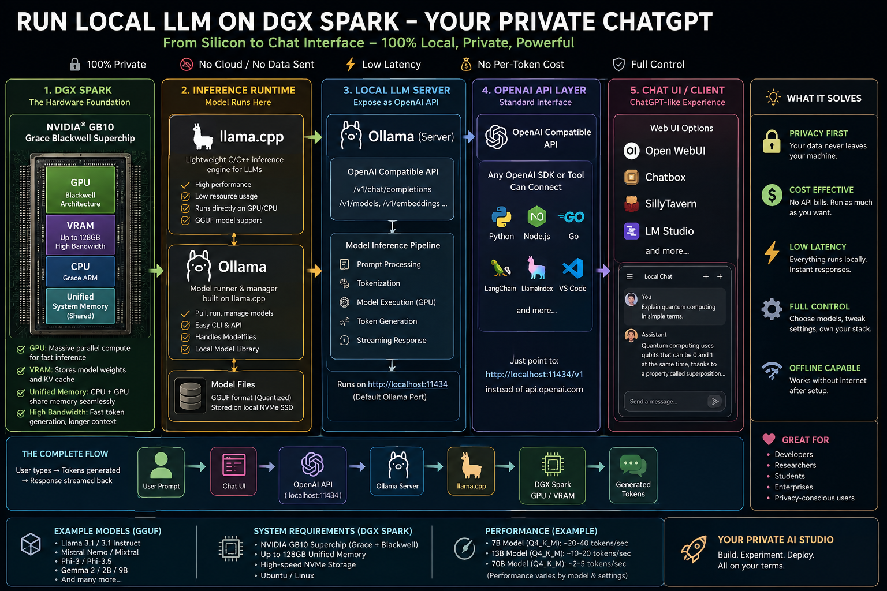

# From Open WebUI to GB10: How a ChatGPT-Like Local LLM Stack Actually Works

> **The short version:** a DGX Spark can turn a browser-based chat experience into a completely local AI stack. The interesting part is not just the model. It is the chain underneath it:
>
> **Open WebUI → OpenAI-compatible API → Ollama :11434 → llama.cpp → GGUF → CUDA → GB10 → 128 GB unified memory**
>
> Once you understand that chain, “running an LLM locally” stops sounding like magic and starts looking like a fairly understandable software-and-hardware pipeline.



**Raw diagram:** https://raw.githubusercontent.com/mkol5222/chkp-public-notes/master/ai/openwebui-on-dgxspark.png

---

## Why build a local ChatGPT-like system?

When most people use an AI assistant, the mental model is simple:

**You type → the cloud AI thinks → an answer appears.**

A local LLM reverses the important part of that model.

Instead of sending the conversation to a remote inference service, you can keep the model, inference engine, API server and chat interface on hardware you control.

That can solve several practical problems:

- **Privacy:** prompts and documents can remain on your own machine.
- **Offline operation:** once the models and software are installed, the core inference path does not require an Internet connection.
- **Predictable access:** you are not dependent on a cloud service being available.
- **Experimentation:** engineers can change models, quantization, context size and inference settings.
- **API control:** applications can talk to a local endpoint rather than being hard-wired to one cloud provider.
- **Cost control:** there is no per-token cloud inference bill for the local inference itself, although the hardware, electricity and operational costs are real.

The catch is equally important: **local does not automatically mean better.** Cloud models can be larger, faster to update, easier to operate at scale and often have capabilities that a local model does not. The attraction of a DGX Spark is that it makes the local side unusually capable in a very small physical footprint.

---

# The entire stack in one line

If you are an engineer, this is the line worth remembering:

```text
Open WebUI
    ↓
OpenAI-compatible /v1/chat/completions
    ↓
Ollama :11434
    ↓
llama.cpp
    ↓
GGUF model
    ↓
CUDA / NVIDIA GPU backend
    ↓
GB10 Blackwell GPU + Grace CPU
    ↓
128 GB coherent unified memory
    ↓
tokens generated locally
```

And the response travels back up the same stack:

```text
GB10
  → generated tokens
  → llama.cpp
  → Ollama
  → API response / streaming chunks
  → Open WebUI
  → browser
  → human
```

That is the architecture hiding behind the deceptively simple chat box.

---

# 1. Start at the bottom: the DGX Spark hardware

At the bottom of the stack is NVIDIA's **DGX Spark**, built around the **GB10 Grace Blackwell Superchip**.

The important architectural detail is that this is not a conventional desktop with a discrete GPU connected to a separate pool of graphics memory.

DGX Spark combines the Grace CPU and Blackwell GPU in a tightly integrated system and provides **128 GB of coherent unified system memory**. NVIDIA lists a 20-core Arm CPU, Blackwell GPU architecture with 5th-generation Tensor Cores, 273 GB/s memory bandwidth and 4 TB NVMe storage for the DGX Spark configuration. 

That memory architecture matters enormously for local LLMs.

## CPU RAM vs. GPU VRAM — the useful mental model

On a traditional PC you might picture:

```text
CPU ─── system RAM
 │
 └── PCIe ─── GPU ─── VRAM
```

The CPU has one memory pool and the GPU has another.

On DGX Spark, the simplified mental model is closer to:

```text
                 ┌── Grace CPU
128 GB unified ──┤
                 └── Blackwell GPU
```

The CPU and GPU can operate on the same coherent system-memory pool.

That does **not** mean every operation is magically free or that memory bandwidth is infinite. It means that large models do not have to fit inside a small, conventional discrete-GPU VRAM pool in the same way.

For local LLM experimentation, that is a big deal.

---

# 2. What actually lives in that memory?

An LLM is ultimately a huge collection of learned numerical parameters called **weights**.

A simplified picture is:

```text
Model
 ├── weights
 ├── tokenizer
 ├── configuration
 └── runtime state
       └── KV cache / context
```

The weights are what encode the model's learned behavior.

When you ask:

> Explain quantum computing to me like I'm five.

the computer does not retrieve a paragraph from a database.

The model processes the input tokens and repeatedly predicts what token should come next.

Very roughly:

```text
"Explain quantum computing..."
          ↓
       tokens
          ↓
     neural network
          ↓
 probability distribution
          ↓
       next token
          ↓
       next token
          ↓
          ...
```

This repeated token generation is called **autoregressive inference**.

---

# 3. Why GGUF matters

You will frequently encounter local models packaged as **GGUF** files.

For example:

```text
some-model-Q4_K_M.gguf
```

GGUF is a model file format used extensively by the llama.cpp ecosystem. It packages the model weights together with metadata needed by the runtime.

The interesting part for local inference is often the **quantization**.

A full-precision model might store weights using relatively high numerical precision. Quantization stores them using fewer bits.

Conceptually:

```text
Higher precision
     ↓
larger model
     ↓
more memory
     ↓
more bandwidth required

Quantized
     ↓
smaller model
     ↓
less memory
     ↓
often faster / easier local inference
```

You might see variants such as:

```text
Q4
Q5
Q6
Q8
```

and more specific schemes such as:

```text
Q4_K_M
```

The trade-off is familiar to engineers:

**less memory and potentially better performance in exchange for some loss of numerical precision.**

The important practical point is that quantization does not turn a 70B model into a 7B model. It makes the same model's representation more compact.

---

# 4. Enter llama.cpp: the inference engine

Now we reach:

```text
GGUF
  ↓
llama.cpp
```

[llama.cpp](https://github.com/ggml-org/llama.cpp) is a C/C++ inference project designed to run LLMs locally across a wide range of hardware.

This is where the model stops being “a file” and becomes an executable neural network.

llama.cpp provides the machinery for things such as:

- loading model weights
- tokenization
- executing neural-network operations
- managing context
- generating tokens
- streaming output
- using CPU and accelerator backends
- serving models through an API

On NVIDIA hardware, llama.cpp can use CUDA-based GPU acceleration.

The project also supports CPU+GPU hybrid inference, which is particularly useful when a model is larger than the memory available on a conventional GPU.

The simplified relationship is:

```text
GGUF model
     ↓
 llama.cpp
     ↓
GPU backend
     ↓
 CUDA
     ↓
NVIDIA GPU
```

---

# 5. CUDA is the bridge to the Blackwell GPU

If llama.cpp is the inference engine, **CUDA is one of the major pieces of the machinery that lets it use NVIDIA GPUs effectively.**

Think of CUDA as the software platform connecting applications and libraries to NVIDIA GPU compute.

The simplified stack becomes:

```text
Application
    ↓
llama.cpp
    ↓
CUDA backend
    ↓
Blackwell GPU
    ↓
Tensor Cores / GPU compute
```

The important word here is **backend**.

llama.cpp is not itself the GPU.

It contains code that expresses the computation, while the appropriate backend executes those operations on the available hardware.

On DGX Spark, that means the inference workload can take advantage of the Blackwell side of the GB10 package.

---

# 6. What does the GPU actually do?

A transformer model contains enormous numbers of mathematical operations.

At a high level, much of inference consists of operations that GPUs are extremely good at performing in parallel.

Instead of:

```text
operation 1
operation 2
operation 3
operation 4
...
```

a GPU can attack large collections of related operations simultaneously.

That is the fundamental reason GPUs became so important to modern AI.

For an LLM, performance is influenced by much more than raw compute.

Engineers will care about:

- memory bandwidth
- kernel efficiency
- model quantization
- context length
- KV-cache size
- batch size
- prompt processing speed
- token generation speed
- CPU/GPU split
- thermal and power limits

For an end user, all of that eventually collapses into one very simple question:

> **How quickly does the answer appear?**

---

# 7. Where Ollama enters the picture

You could interact with llama.cpp more directly, but most people do not want to manually manage every model and inference command.

That is where **Ollama** becomes useful.

The conceptual relationship is:

```text
Ollama
   ↓
model management + serving
   ↓
inference runtime
   ↓
llama.cpp / supported backend
   ↓
hardware
```

Ollama provides a convenient way to pull, manage and run models and expose them through an API.

Its local API is normally available at:

```text
http://localhost:11434/api
```

and its OpenAI-compatible interface uses:

```text
http://localhost:11434/v1/
```

The distinction is worth remembering:

```text
/api
```

is Ollama's native API.

```text
/v1
```

is the OpenAI-compatible API surface.

Ollama's documentation explicitly demonstrates using the standard OpenAI Python client by changing the `base_url` to:

```text
http://localhost:11434/v1/
```

This is one of the most useful tricks in the local-LLM ecosystem.

---

# 8. Why “OpenAI-compatible” is such a big deal

Suppose your application was originally written to talk to an OpenAI-style API.

You might have code conceptually like:

```python
client = OpenAI(
    base_url="https://some-provider.example/v1/",
    api_key="..."
)
```

If the application supports an OpenAI-compatible endpoint, you can instead point it at:

```text
http://localhost:11434/v1/
```

and use a locally served model.

The API convention acts like a **universal adapter**.

It does not mean:

> “Ollama is OpenAI.”

It means:

> “Ollama speaks enough of the same API protocol that applications designed around that protocol can communicate with it.”

That distinction is important.

---

# 9. The famous endpoint: `/v1/chat/completions`

For a ChatGPT-like interaction, the endpoint worth remembering is:

```text
POST /v1/chat/completions
```

A simplified request looks like:

```json
{
  "model": "my-local-model",
  "messages": [
    {
      "role": "user",
      "content": "Explain quantum computing simply."
    }
  ]
}
```

The request arrives at the local Ollama service.

Ollama passes the workload into the inference stack.

The model generates tokens.

The server streams the response back.

Conceptually:

```text
POST
/v1/chat/completions
        │
        ▼
     Ollama
        │
        ▼
   llama.cpp
        │
        ▼
     CUDA
        │
        ▼
     GB10
        │
        ▼
  generated tokens
        │
        ▼
 streaming HTTP response
```

The user sees none of that.

They see:

> Quantum computing uses...

That is the beauty of a layered architecture.

---

# 10. Then comes Open WebUI

Now we finally reach the part most people actually care about:

**the chat window.**

[Open WebUI](https://github.com/open-webui/open-webui) is a self-hosted interface designed to provide a friendly AI experience while connecting to model backends through supported protocols.

Its architecture is deliberately provider-oriented.

Instead of requiring the UI to understand every inference engine in existence, it can communicate with servers that implement compatible APIs.

That means:

```text
Open WebUI
     │
     ├── Ollama
     ├── OpenAI-compatible server
     ├── other compatible providers
     └── cloud providers
```

For our local DGX Spark setup:

```text
Browser
   ↓
Open WebUI
   ↓
Ollama
   ↓
llama.cpp
   ↓
CUDA
   ↓
GB10
```

Now your local model has a familiar interface.

You get conversations, model selection and a browser-based experience instead of staring at a terminal.

---

# 11. The whole request, from keyboard to silicon

Let's follow one message all the way down.

You type:

> Summarize this document in five bullet points.

### Step 1 — Browser

Open WebUI receives your message.

### Step 2 — API layer

The UI turns the conversation into an API request.

Conceptually:

```text
POST /v1/chat/completions
```

### Step 3 — Ollama

Ollama receives the request on its local service endpoint, commonly:

```text
localhost:11434
```

It identifies the requested model and prepares the inference request.

### Step 4 — llama.cpp

The inference runtime loads or uses the model and prepares the prompt.

Text is converted into **tokens**.

### Step 5 — CUDA

The GPU-capable parts of the computation are dispatched through the NVIDIA software stack.

### Step 6 — GB10

The Blackwell GPU performs huge numbers of parallel mathematical operations using the model's weights and runtime state.

### Step 7 — Token generation

The model predicts the next token.

Then another.

Then another.

For example:

```text
"The"
   ↓
"document"
   ↓
"contains"
   ↓
"five"
   ↓
"important"
   ↓
"ideas"
```

Obviously, real tokenization is more complicated than one word = one token.

### Step 8 — Streaming

The generated output can be streamed back rather than waiting for the entire response to finish.

### Step 9 — Open WebUI

The UI receives the response and renders it as a conversation.

### Step 10 — Human

You see:

> • First important point  
> • Second important point  
> • Third important point...

And you never needed to know that the answer just traveled through a C++ inference engine, CUDA kernels and a Blackwell GPU.

---

# 12. Why the 128 GB unified memory changes the conversation

This is arguably the most interesting DGX Spark-specific part.

NVIDIA positions DGX Spark as a desktop AI system with **128 GB of coherent unified system memory** and support for models up to roughly 200 billion parameters on a single system, with larger configurations possible using two connected systems.

That does not mean:

> “Every 200B model will run fast.”

It means the hardware architecture gives you a much larger memory envelope for local AI experimentation than a typical consumer GPU.

Model size, quantization, context, runtime overhead and performance targets still matter.

A useful engineer's equation is not simply:

```text
model parameters < memory
```

It is closer to:

```text
model weights
+ KV cache
+ runtime buffers
+ context
+ OS / application memory
+ overhead
≤ available memory
```

And even if everything fits, **fitting is not the same as running quickly**.

Memory bandwidth and compute throughput still determine how fast inference proceeds.

---

# 13. What is the KV cache?

The **KV cache** is one of those terms that sounds obscure until you understand why it exists.

During autoregressive generation, the model repeatedly processes a growing conversation.

Without caching, the system would repeatedly redo some work from earlier tokens.

The KV cache stores intermediate attention-related information from previous tokens so the runtime can reuse it.

Simplified:

```text
Prompt
  ↓
tokens
  ↓
attention computation
  ↓
KV cache
  ↓
next token
  ↓
more tokens
  ↓
reuse cached state
```

The catch is that the KV cache itself consumes memory.

And as context length grows, memory requirements can grow substantially.

That is why:

> **“My model fits!”**

does not necessarily mean:

> **“I can give it a gigantic context window and everything will be fine.”**

---

# 14. Why local LLMs feel different from cloud AI

The user experience can be surprisingly similar:

```text
┌───────────────────────────────┐
│  Open WebUI                   │
│                               │
│  You: Explain this report.    │
│                               │
│  AI: Here are the key ideas…  │
│                               │
│  [_________________________]  │
└───────────────────────────────┘
```

But underneath:

### Cloud AI

```text
Browser
   ↓
Internet
   ↓
Cloud API
   ↓
Remote GPU cluster
   ↓
response
```

### Local DGX Spark

```text
Browser
   ↓
Open WebUI
   ↓
localhost / LAN
   ↓
Ollama
   ↓
llama.cpp
   ↓
CUDA
   ↓
GB10
   ↓
128 GB unified memory
```

That is the fundamental difference.

---

# 15. What this architecture solves for normal humans

You do not need to be an AI engineer to care about this.

## Privacy

If the whole inference path is local, a confidential document does not have to be uploaded to a third-party inference service.

That can be valuable for:

- source code
- internal documents
- research notes
- proprietary designs
- personal archives

There are still operational considerations, of course: backups, logging, networking, plugins and other connected services can change the privacy picture.

## Control

You choose the model.

You choose when to upgrade it.

You choose the runtime.

You choose where the data is stored.

## Experimentation

You can compare models without rewriting the entire application.

For example:

```text
Open WebUI
     │
     ├── Model A
     ├── Model B
     ├── Model C
     └── Model D
```

The interface stays familiar while the model underneath changes.

## Local automation

Once you have an API endpoint, the model is no longer just a chat toy.

Other programs can call it.

For example:

```text
Python application
       ↓
OpenAI-compatible client
       ↓
localhost:11434/v1
       ↓
Ollama
       ↓
local model
```

That opens the door to local agents, document processing, RAG systems, coding assistants and internal tools.

---

# 16. The architecture is really a set of interchangeable layers

This is the deeper engineering lesson.

The stack is not one monolithic application.

It is a collection of layers:

| Layer | Example | What it solves |
|---|---|---|
| Hardware | GB10 / DGX Spark | Provides compute + memory |
| GPU software | CUDA | Lets software use NVIDIA GPU compute |
| Inference engine | llama.cpp | Executes the neural network |
| Model format | GGUF | Stores model weights + metadata efficiently |
| Model server | Ollama | Manages models and exposes APIs |
| API protocol | OpenAI-compatible `/v1` | Gives applications a familiar interface |
| UI | Open WebUI | Gives humans a ChatGPT-like experience |

This separation is extremely useful.

You can change one layer without necessarily changing everything above it.

For example:

```text
Open WebUI
      │
      ├──────────────┐
      ↓              ↓
   Ollama        another
      │          compatible
      ↓            server
   model
```

Or:

```text
Application
     ↓
OpenAI-compatible API
     ↓
different local backend
     ↓
different inference engine
```

That is why API compatibility has become such a powerful pattern in the local-LLM ecosystem.

---

# 17. A useful way to remember the whole thing

If you only remember one analogy, use this:

### The DGX Spark is the factory.

It provides the physical machinery.

### CUDA is the industrial control system.

It gives software a way to use NVIDIA's GPU hardware.

### llama.cpp is the engine room.

It performs the actual model inference.

### GGUF is the packaged recipe/material.

It contains the model representation the runtime can load.

### Ollama is the service manager.

It makes running and serving models much easier.

### `/v1/chat/completions` is the standardized loading dock.

Applications know how to send requests there.

### Open WebUI is the showroom.

Humans interact with the AI through a polished browser interface.

And the LLM itself?

**That is the learned intelligence being executed inside the factory.**

---

# 18. The final architecture

Put everything together:

```text
┌─────────────────────────────────────────────────────────────┐
│                         HUMAN                               │
│                    "Ask a question"                         │
└──────────────────────────┬──────────────────────────────────┘
                           │
                           ▼
┌─────────────────────────────────────────────────────────────┐
│                      OPEN WEBUI                             │
│             ChatGPT-like browser interface                  │
└──────────────────────────┬──────────────────────────────────┘
                           │
                           │ OpenAI-compatible API
                           │ POST /v1/chat/completions
                           ▼
┌─────────────────────────────────────────────────────────────┐
│                    OLLAMA :11434                            │
│             model management + API server                   │
└──────────────────────────┬──────────────────────────────────┘
                           │
                           ▼
┌─────────────────────────────────────────────────────────────┐
│                       llama.cpp                             │
│       tokenization • inference • context • streaming        │
└──────────────────────────┬──────────────────────────────────┘
                           │
                           ▼
┌─────────────────────────────────────────────────────────────┐
│                    GGUF MODEL                               │
│          quantized weights + metadata                       │
└──────────────────────────┬──────────────────────────────────┘
                           │
                           ▼
┌─────────────────────────────────────────────────────────────┐
│                       CUDA                                  │
│            NVIDIA GPU acceleration layer                    │
└──────────────────────────┬──────────────────────────────────┘
                           │
                           ▼
┌─────────────────────────────────────────────────────────────┐
│                  NVIDIA GB10 / DGX SPARK                    │
│                                                             │
│     Grace CPU + Blackwell GPU + 128 GB unified memory       │
│                                                             │
│              model weights + KV cache + runtime             │
└──────────────────────────┬──────────────────────────────────┘
                           │
                           ▼
                    generated tokens
                           │
                           └───────────────► back to Open WebUI
```

The entire journey can therefore be compressed into:

```text
OPEN WEBUI
    ↓
/v1/chat/completions
    ↓
OLLAMA :11434
    ↓
llama.cpp
    ↓
GGUF
    ↓
CUDA
    ↓
GB10
    ↓
128 GB unified memory
    ↓
tokens
    ↓
OPEN WEBUI
```

That's a local LLM.

Not merely a model running on a computer, but a **complete stack from silicon to user interface**.

---

# References and further reading

- [NVIDIA DGX Spark specifications](https://www.nvidia.com/en-us/products/workstations/dgx-spark/)
- [NVIDIA DGX Spark Hardware Overview](https://docs.nvidia.com/dgx/dgx-spark/hardware.html)
- [llama.cpp](https://github.com/ggml-org/llama.cpp)
- [Ollama API introduction](https://docs.ollama.com/api/introduction)
- [Ollama OpenAI compatibility](https://docs.ollama.com/api/openai-compatibility)
- [Open WebUI](https://github.com/open-webui/open-webui)
- [Open WebUI — Ollama connection](https://docs.openwebui.com/getting-started/quick-start/connect-a-provider/starting-with-ollama/)
- [Open WebUI — OpenAI-compatible providers](https://docs.openwebui.com/getting-started/quick-start/connect-a-provider/starting-with-openai-compatible/)

---

## Footnote

This article was generated with assistance from **ChatGPT (GPT-5.6 Luna)** on **September 2, 2026**.
