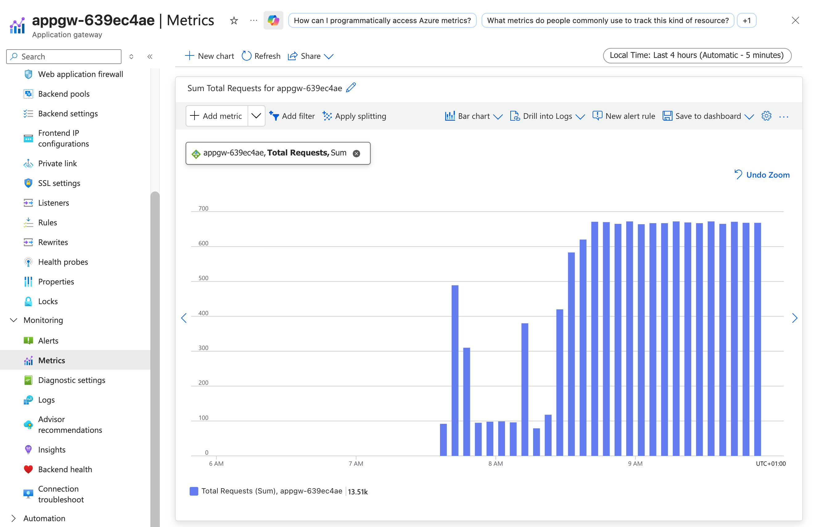
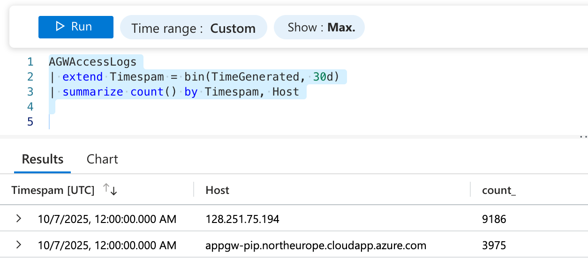

# Estimate CloudGuard WAF license with Azure Application Gateway

[Azure Application Gateway](https://learn.microsoft.com/en-us/azure/application-gateway/overview) is layer 7 load balancing and popular solution to publish web applications in Azure. It provides features such as SSL termination, cookie-based session affinity, and traditional web application firewall (WAF) capabilities.

There is good chance that most of web applications in your Azure environment are already published using Application Gateway, so all their inbound traffic is passing through it. 

In this case, you can leverage existing Application Gateway metrics and logs to estimate required CloudGuard WAF license size by number of HTTP requests to published applications.

## Prerequisites

- Application Gateway is deployed in your Azure environment
- Application Gateway diagnostics logs are enabled and sent to Log Analytics workspace. See [Enable diagnostics logging for Application Gateway](https://learn.microsoft.com/en-us/azure/application-gateway/monitor-application-gateway#enable-diagnostics-logging-for-application-gateway) for more details.

## Metrics and logs to review

- Application Gateway metrics: `Total Requests` metric shows the total number of requests that were received by the Application Gateway. You can find this metric in the Azure portal under your Application Gateway's "Metrics" section.
- Application Gateway access logs: `ApplicationGatewayAccessLog` contains detailed information about each request processed by the Application Gateway, documented for your reference in [Application Gateway access logs](https://learn.microsoft.com/en-us/azure/azure-monitor/reference/tables/agwaccesslogs).

## Estimating WAF license size

1. Go to the Azure portal and navigate to your Application Gateway instance.
2. In the left-hand menu, select "Metrics" under the "Monitoring" section.
3. In the Metrics blade, select the `Total Requests` metric from the dropdown menu.
4. Set the time range to the desired period (e.g., last 30 days).
5. Review the total number of requests received by the Application Gateway during that period.



This is total number of HTTP requests that your web applications are receiving. You can use this number to estimate the required CloudGuard WAF license size based on the number of requests.
Metrics do not provide per application breakdown, so if you need to estimate WAF sizing for specific applications, you can use Application Gateway access logs.


### Using Log Analytics to analyze access logs

1. Go to the Azure portal and navigate to your Log Analytics workspace where Application Gateway diagnostics logs are sent.
2. In the left-hand menu, select "Logs" under the "General" section.
3. Make sure that relevant (long engough) time range is selected in the top.
4. Use the following Kusto Query Language (KQL) query to analyze the access logs and get the total number of requests per application (per Host):

```kql
AGWAccessLogs
| extend Timespam = bin(TimeGenerated, 30d)
| summarize count() by Timespam, Host
```



This query will give you the total number of requests per application (based on Host header) for the selected time range. You can adjust the time binning as needed (e.g., daily, weekly, monthly) by changing the `bin` function parameter.

## Summary

Assuming that all/most application traffic is passing through Azure Application Gateway, you can leverage its metrics and logs to estimate required CloudGuard WAF license size by number of HTTP requests to published applications.
This approach provides accurate and reliable data for WAF sizing, ensuring that your web applications are adequately protected.